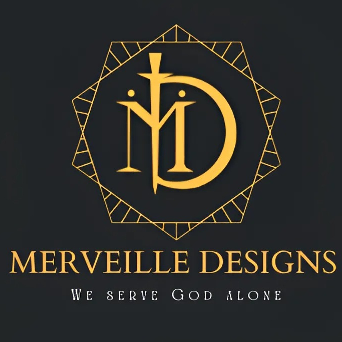

# Merveille Designs

**An architectural practice workspace for projects, clients and the people delivering them.**

This branch contains an existing Next.js/OpenNext application on Cloudflare, its specifications and brand assets. The current assignment is to improve the foundation: consistent premium styling, real Google-account access and targeted functional repairs. It is **not yet a verified production release**.

## Next agent: start here

Read **[NEXT_AGENT.md](NEXT_AGENT.md)** for the short kickoff, then [START_HERE.md](START_HERE.md) and the **[current remediation work order](docs/remediation/README.md)**. The application lives on `implement/merveille-portal`; do not scaffold a replacement from the planning-only default branch.

| Current document | Purpose |
|---|---|
| [Product amendment](docs/remediation/01-product-amendment.md) | Latest user decisions and preserved business scope |
| [Real accounts and testing](docs/remediation/02-identity-and-real-user-testing.md) | Google sign-in, Jay bootstrap, admins, invitations and scoped access |
| [Premium interface](docs/remediation/03-premium-interface.md) | Neutral design system, shared shells/components and every route |
| [Functional repairs](docs/remediation/04-functional-repairs.md) | Publication, permissions, financial integrity, reminders and recovery |
| [Delivery and acceptance](docs/remediation/05-delivery-and-acceptance.md) | R00–R05 work sequence, verification and real-person UAT |
| [Task state](task.md) and [manifest](docs/remediation/manifest.json) | Honest progress and resumable dependencies |
| [AGENTS.md](AGENTS.md) and [skills/tools](docs/implementation/skills-and-tools.md) | Repository rules and reviewed project-local guidance |

## Current direction

The interface will use white, cool gray and graphite, readable typography and a compact existing logo at the top. The old warm/gold specimen is superseded. Branding remains **Merveille Designs**; the supplied company artwork is preserved.

People use their own invited Google accounts. Jay is the initial administrator and can add another admin; admins assign teammates, consultants and clients appropriate project access. The final app has no demo login, role selector or impersonation. Approximately three real people perform initial testing, without an account cap.

This documentation update prepares that work; it does not change or deploy the application. The previously inspected preview is [merveille-web.rhelo-bible.workers.dev](https://merveille-web.rhelo-bible.workers.dev). Its current deployment must be verified during remediation. Historical phase checkmarks do not establish that real authentication, integrations, recovery or the redesigned screens are complete.

## Product scope

- Enquiries, requirements, site feasibility and quotations; activation after acceptance and admin-confirmed advance.
- Multiple client projects and separate representative identities.
- Tasks, drawings, site updates, manual K-SMART records, materials, changes and snags.
- Consultant approval of an exact drawing version followed by manager final release; manager publication of ordinary updates.
- Quotations, schedules, invoices, receipts, expenses and consultant fees. Salaries/profit are ADMIN-only; individual performance is OWNER-only.
- Consultants see assigned client quotation/payment history while internal records stay private.
- Waiting-on-you, in-portal/WhatsApp reminders and unresolved overdue escalation.
- Archived records remain available to authorized clients/consultants, with recoverable long-term storage.

Operating baseline: around 30 projects and 10–15 concurrent users, desktop/phone, online-only, documents/photos/large drawings/site videos. No payment gateway, offline sync, handover-pack generator or AI assistant is requested.

## Architecture and specifications

Preserve the existing Next.js App Router/OpenNext adapter and Cloudflare Workers, D1, private R2 and Wrangler configuration. Complete durable jobs and integrations through the current repair plan. No framework migration is part of the visual redesign.

The [documentation index](docs/README.md) links the original requirements, 20 screen contracts, workflows, architecture and acceptance catalogue. They remain useful specifications where unchanged. [P00–P14](docs/implementation/roadmap.md) is the historical build sequence; **R00–R05 is active**.

The [brand package](assets/brand/README.md) records the original artwork from [Merveille Designs' Refrens profile](https://www.refrens.com/merveille-designs), source URLs and hashes. Preserve the PNGs; interface tokens are separate implementation choices.

## Verify the documentation

Run `node scripts/check-handoff.mjs` from the repository root. It checks links, original phase/acceptance mappings and brand integrity. It does not test the application or prove release readiness. Application verification belongs to the implementing agent and the recorded real-account UAT.

No private client records, personal addresses, drawings, payroll or credentials belong in this public repository.
