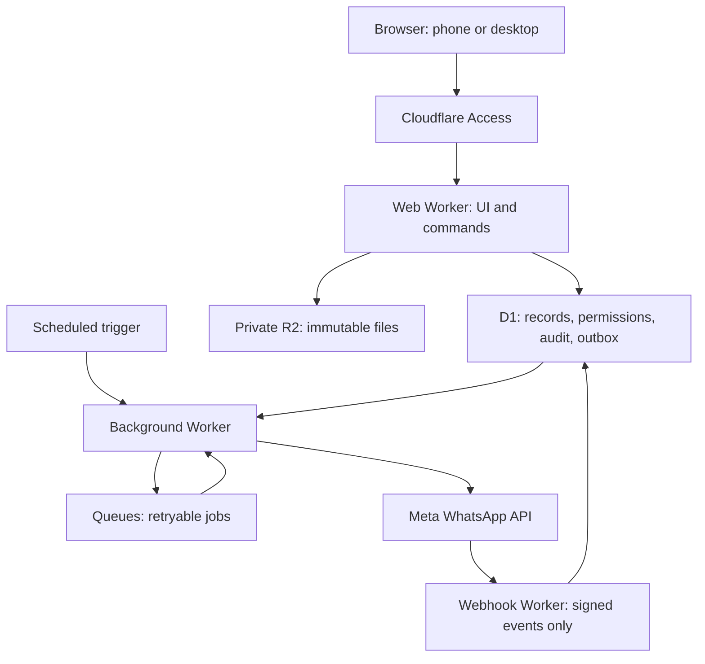

# Architecture overview

**27 November 2026 next-phase scope:** [The active N00–N05 plan](../next-phase/README.md) supersedes conflicting instructions below. Use Cloudflare Free only, bounded open-source voice, external billing with version-bound ADMIN commercial clearance, and manually prepared WhatsApp messages with API delivery disabled. Preserve completed work, historical records, access/approval rules and applicable recovery gates. Older finance/provider setup and execution sequences below are retained as reference; they are not current work or permission to enable paid services.

Status: architecture contract for the existing foundation, with open integration/verification work. Follow the [current remediation plan](../remediation/README.md), [product requirements](../product/requirements.md) and [permissions](../product/roles-and-permissions.md). Technical source notes below were checked 24 November 2026; they do not prove deployed readiness.

## Decision

Build one responsive, online application using Next.js App Router conventions and TypeScript, deployed to Cloudflare Workers. Keep application data in D1 and private R2. Use a separate background Worker for reminders and durable job handling. The initial scale is approximately 30 projects and 10–15 concurrent users; total registered identities may be higher because clients and their representatives have individual logins.

The implemented runtime uses Next.js App Router and the OpenNext Cloudflare adapter, as recorded in [ADR 0001](decisions/0001-runtime.md). Preserve that foundation during remediation. The original P00 exploration of vinext is historical; a visual redesign does not require restarting it or migrating adapters. Verify the existing build in workerd and change runtime only for a demonstrated compatibility issue with a new recorded decision.

An in-product ChatGPT assistant, autonomous drawing approval and AI access to project documents remain outside the confirmed scope. AI-assisted implementation does not imply a runtime AI dependency.

## System boundaries

The diagram expresses logical boundaries. The webhook can share a deployment with background handlers if its only public routes are verified Meta callbacks and health checks. It must never expose admin provisioning or job execution endpoints.

| Responsibility | Chosen building block | Rules |
|---|---|---|
| UI, server rendering, business commands | Existing Next.js App Router on a Cloudflare Worker via OpenNext | One server-side domain service layer; route handlers and server actions share it |
| Login | Cloudflare Access | Invite-only application accounts; validate JWT; D1 remains the permission authority |
| Relational records | D1 | Prepared SQL, migrations, scoped queries, transactional commands, integer money |
| Documents/media | Private R2 | No public project bucket, immutable version objects, authenticated download gate |
| Reminders and asynchronous work | D1 outbox, Queues, scheduled Worker | Idempotent processing, retry/dead-letter state, permission recheck before send |
| WhatsApp delivery | Meta Cloud API adapter invoked by Worker | External messaging destination; application compute and records remain on Cloudflare |
| Long-term recovery copies | Separate private R2 backup resource and scheduled export job | Separate permissions; restoration exercise; retention is an operational responsibility |
| Observability | Structured Worker logs, Cloudflare metrics, application job status | No document contents, salary details, JWTs, tokens, or signed URLs in logs |

Wrangler configuration and generated binding types are the deployment source of truth. Access applications/policies and Meta sender registration also need setup; **Wrangler alone does not create every identity policy or external messaging account**. Record these dependencies in [environment setup](../operations/environments.md).

## Historical compatibility spike and adapter exit criterion

The existing ADR records the choice. Retain the following as original evaluation criteria, not a new remediation stage.

The builder creates a disposable scaffold or isolated branch, then demonstrates these capabilities in the Workers runtime:

1. App Router page, server rendering, a form mutation, cookie/header access, and a protected route.
2. D1 migration/query/batch, an R2 streamed upload/download, and generated binding types.
3. The UI component library, file preview approach, supported Node compatibility, and runtime dependency bundle.
4. Local Workerd preview and a staged deployed smoke test when deployment is authorised.
5. A documented exact version matrix and lockfile. Do not merely record “latest.”

Start with vinext, following the current official scaffold. If a concrete blocker prevents the required use cases, record the reproduced blocker and use the officially supported OpenNext path. Do not mix both adapters in production. Do not copy an OpenNext `.open-next/worker.js` entry path into a vinext deployment. Do not infer a deployment command from an old blog post. The current Cloudflare framework and automatic-configuration pages contain different migration paths, so test the selected explicit configuration rather than depending on auto-detection.

## Proposed code boundaries

These are target directories for the implementation agent, not files that already exist:

| Target area | Responsibility |
|---|---|
| `src/app/` | Routes, layouts, server-rendered screens, route handlers |
| `src/components/` | Accessible reusable presentation components; no authorization authority |
| `src/features/` | Screen-specific forms and UI adapters |
| `src/server/auth/` | Access JWT verification, principal construction, permission policies |
| `src/server/domain/` | Project, drawing, update, invoice, payment, task and snag commands |
| `src/server/db/` | D1 query functions, scoped row types, transaction helpers |
| `src/server/files/` | Upload sessions, R2 key assignment, previews and downloads |
| `src/server/notifications/` | Message policies, outbox records, adapters and templates |
| `src/shared/` | Validation schemas, non-sensitive enums, money/date formatting |
| `workers/jobs/` | Scheduled scans, outbox dispatch, queue handling, delivery reconciliation |
| `workers/identity/` | Narrow Access allowlist reconciliation if API-driven invitations are enabled |
| `migrations/` | Ordered D1 SQL migrations, never production data |
| `tests/` | Domain, authorization, runtime integration and end-to-end tests |

The identity Worker is an administrative control-plane boundary. It can be omitted only if invitation provisioning is explicitly operated outside the app; the admin UI must then display the real pending-provisioning state. Do not pretend an invitation is usable before the Access policy allows it.

## Server-authoritative operations

The browser never decides project activation, drawing release, additional-work eligibility, financial visibility or payment confirmation. Each command performs fresh identity and project authorization, validates the expected revision, applies its legal transition, writes audit/outbox records, and returns a filtered view. The underlying constraints are in [data model](data-model.md) and [API contracts](api-contracts.md).

Most authenticated HTML, JSON and document responses should be dynamic and private with no shared caching. Never put user/project-specific data in build-time output, static generation, a shared Next.js cache, or a public Worker cache. Small public design assets can be cached normally. The app requires internet access; there is no offline queue or offline document cache.

## Decisions deliberately not added

No external database, Supabase, Firebase, Vercel backend, VM, payment gateway, K-SMART scraper, handover pack, browser automation of government portals, persistent chat server, or speculative microservices. KV is not an authorization database. Durable Objects and Workflows are available Cloudflare options, but add them only for a concrete requirement; a Workflow for long-running backup export is justified if chosen. Browser CAD/BIM editing and video transcoding are not prerequisites; provide safe downloads and an honest unsupported-preview state.

## Completion evidence

An architecture claim is complete only when the selected package versions, binding names, migrations, authorization matrix tests, real Worker smoke results, private-file checks, backup restoration, and notification adapter evidence are recorded. Mock data can prove presentation; it cannot prove those integration properties.
